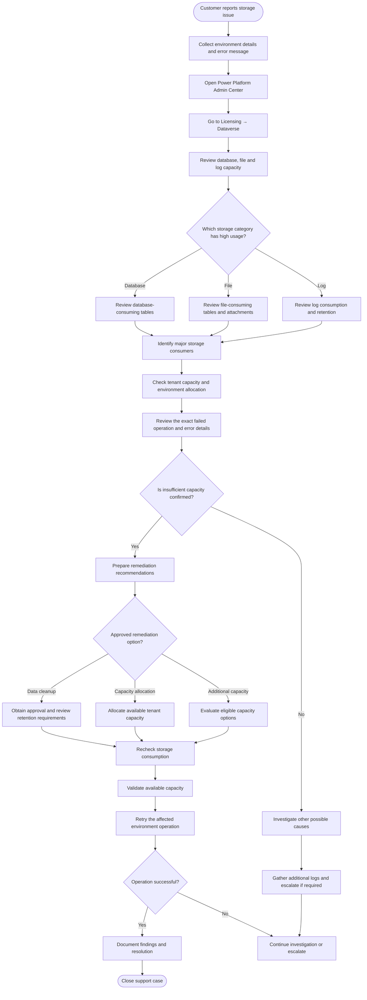

# Dataverse Storage Troubleshooting Workflow

This flowchart represents the investigation process for a simulated Dynamics 365 CE / Dataverse storage capacity issue.

**Note:** This is a simulated troubleshooting workflow. Actual investigation steps and remediation depend on the customer's tenant configuration, permissions and error details.
